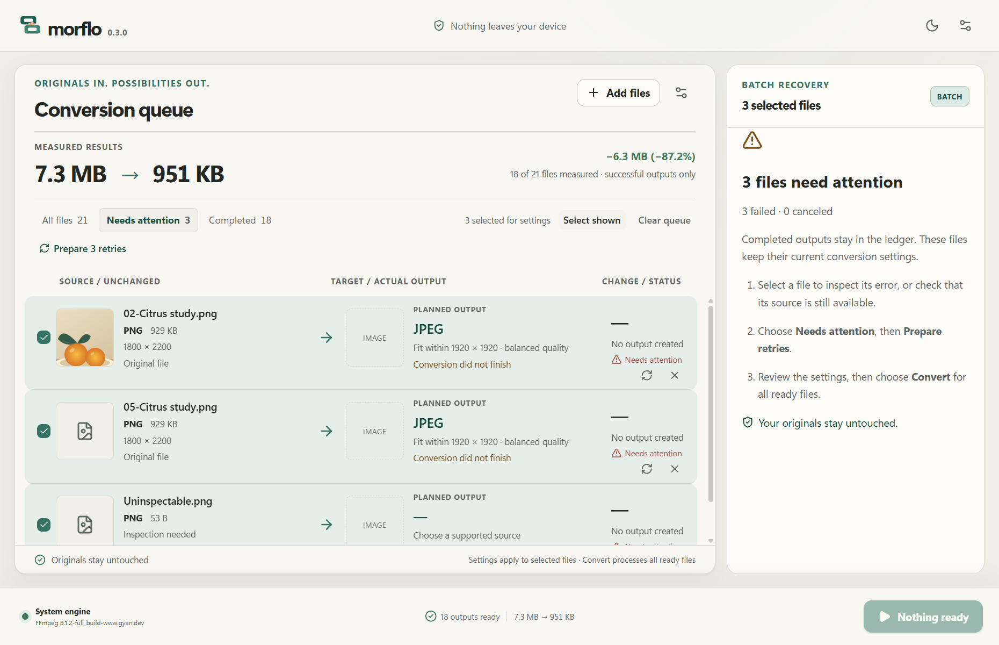

# Batch recovery without losing the ledger

## Problem and decision

The source-to-output ledger makes an individual conversion understandable, but
a mixed twenty-file session still required finding and retrying failures one by
one. The next milestone makes that interrupted session finishable.

Use three small, persistent filter buttons in the existing queue toolbar: All
files, Needs attention, Completed. Keep full-queue measured totals above them.
This preserves the conversion relationship and avoids spending another header
row on controls in the normal workflow. Failed and canceled files share a
recovery view; larger but valid outputs remain Completed.

The recovery action says **Prepare retries**, because it restores editability
and retries inspection rather than encoding immediately. Prepared files return
to All files and become the settings selection. The usual Convert action remains
explicitly queue-wide. A failed reinspection remains visible as a failure.

## Interaction boundaries

- Switching views excludes hidden files from settings and Delete. Select shown
  operates only on the current view. Filtering never removes files or outputs.
- Async progress does not change the chosen view or steal focus. If the view
  empties, explain it and offer Show all files.
- An explicit retry moves focus to the prepared selection. Removing the last
  visible row returns focus to the active filter, not the document body.
- Serialize reinspection and guard duplicate preparation. Never restart a
  successful job, infer animation consent, or silently process ready files.
- Failed rows show a concise error title; selecting them opens the existing
  detailed explanation. A wholly unsuccessful selection receives recovery
  instructions instead of a misleading zero-output completion receipt.

The focus and announcement choices were checked against W3C guidance on
[focus order](https://www.w3.org/WAI/WCAG22/Understanding/focus-order.html) and
[status messages](https://www.w3.org/WAI/WCAG22/Understanding/status-messages.html).
These inform the design; automated checks alone do not establish comprehensive
assistive-technology conformance.

## Evidence

Browser journeys cover mixed completed/failed/canceled/ready files, keyboard
filters, preserved totals, settings scope, empty views, removal focus, minimum
size and queue-wide conversion while filtered. Native Windows evidence adds
real source failures, unsuccessful reinspection, preserved settings and hashes,
and exact output counts proving successful files were not processed again.
Current results are recorded in [status](../STATUS.md).

Unretouched client capture from the installed application. The two moved sources
were later restored and converted successfully; the damaged input stayed failed.
The sample media and capture context are documented in
[showcase provenance](../quality/showcase-capture.md).
