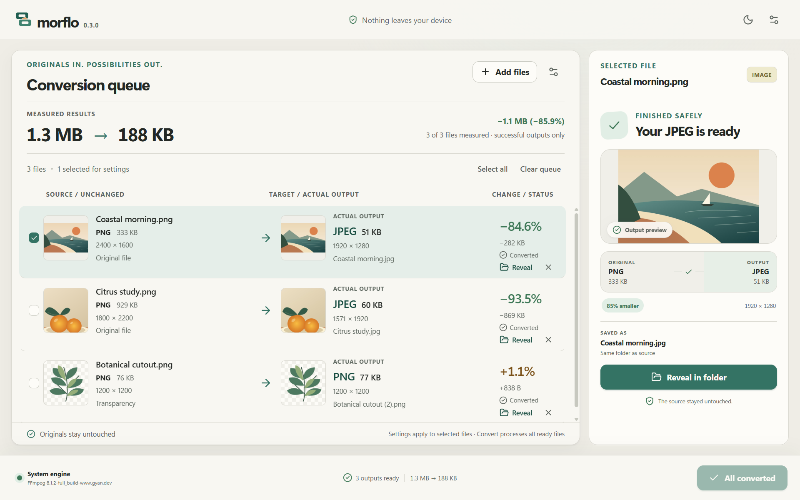
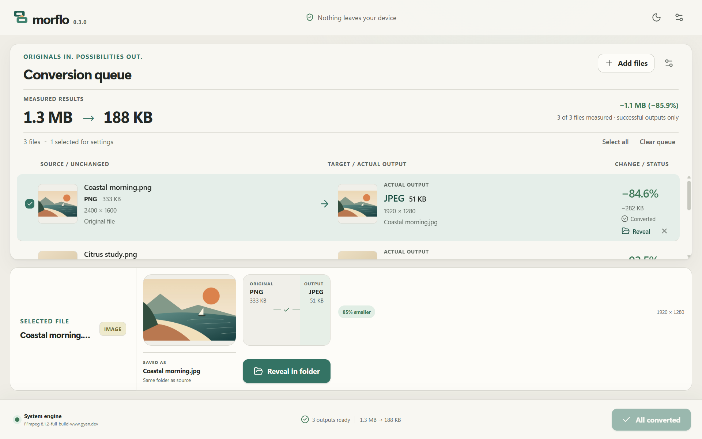

# Conversion ledger

The previous interface asked people to infer a conversion from a filename, a
format chip and a separate receipt. This iteration makes the source-to-output
relationship the working unit of the application.

## Baseline and reference

The inspected baseline was source checkpoint 0.3.0, commit `6ae3463`, with a clean
working tree. The earlier 0.2.1 observation was stale. This work keeps the version
at 0.3.0; it is a local implementation checkpoint, not a new published release.

IconFlow's local README, homepage source and `workflow-1200x630.png` were studied
read-only. Its strength is the connection between a recognizable artifact, a
visible decision and proof of the delivered result. Morflo adopts that discipline,
not IconFlow's artwork, red palette or website layout. Morflo's existing folded
contact-strip mark remains appropriate. The green source/output relationship,
warm paper surfaces and restrained amber size increases extend that identity.

## Two working compositions

Both studies were captured from the same live Tauri session, using the same
three original illustrations, selected file and measured conversion outputs.
The alternate study changes only layout CSS over the running application; its
controls and results remain real. It is an experiment, not the shipped layout.

| Composition                                   | Strength                                                                                         | Cost                                                                              | Decision |
| --------------------------------------------- | ------------------------------------------------------------------------------------------------ | --------------------------------------------------------------------------------- | -------- |
| A: horizontal ledger with a right inspector   | Repeated source → output pairs, nearby actions, several visible results; inspector can be hidden | Side inspector needs its own scrolling for manual video settings                  | Selected |
| B: full-width ledger above a bottom workbench | Generous horizontal source/output space                                                          | Consumes scarce height and pushes most batch results below the fold at 1280 × 800 | Rejected |

## Information and interaction contract

- Every row has stable source, target/output, signed change, status and action
  slots. Completion changes their contents without changing row height.
- Queued targets say **Planned output**, describe the request and reserve an
  empty preview slot. They do not predict bytes or display the source as a
  fictional output. Completed targets say **Actual output** and use the
  backend's measured format, dimensions, bytes and filename.
- The total compares originals and outputs from exactly the same successful,
  measured subset, with an explicit `n of m files measured` denominator.
- Increases use a positive sign and amber. A successful file is not necessarily
  a smaller file. Preview availability never determines whether a result exists.
- Visible rows request source/output previews serially. Offscreen requests are
  skipped and offscreen image state is released. No filesystem or shell
  authority was added to the frontend. Existing bounded Rust preview commands
  remain the only access path.
- Outcome choices remain direct. Manual format, quality, dimensions and metadata
  are under **Manual settings**. Transparency and animation decisions stay
  outside that disclosure. Active jobs cannot change their conversion settings.
- Selection controls settings; **Convert** processes all ready files. The
  ledger states both scopes. Reveal, Retry, Cancel and Remove remain available
  on rows, including at the minimum window width.
- Video without a media engine gets a setup action leading to existing engine
  diagnostics, retains its source, and can be retried after setup.
- At 960 × 640 and 780 × 620, the inspector follows the ledger in a scrollable
  workspace. Hiding it gives the ledger the full workspace. Controls retain
  their text size and keyboard access.

## Refinement beyond the first pass

The first working ledger still spent too much height on framing and only showed
two results. Reduced vertical chrome, compact rows and a manual-settings
disclosure now expose all three showcase results at 1280 × 800. The source and
output sizes share a line with their format; this also prevents row jumps.
Checkerboards are restricted to alpha-bearing images instead of implying that
opaque letterboxing is transparency. Narrow-layout footer clipping was fixed,
and the native capture procedure now respects the host's 150% display scaling.
The animation journey exposed duplicate warnings; the dedicated consent control
now carries that warning once.

## Visual review

The full native window and both themes were inspected, as were the actual
1200 × 750, 480 × 300 and 320 × 200 portfolio files. At 480, the paired pictures,
PNG → JPEG relationship and signed results remain recognizable. At 320, the
mark, summary arrow and repeated transformation pattern survive; small control
labels are not presented as readable at that size.

Against IconFlow's presentation, Morflo now provides the same kind of concrete
artifact-to-result proof and actual-size review. The improvement is substantial,
but it is not an independent claim that every aesthetic dimension exceeds
IconFlow. These are restrained product captures, not a cinematic brand film.

See [capture and provenance](../quality/showcase-capture.md) for reproduction,
measured evidence and the portfolio handoff.
